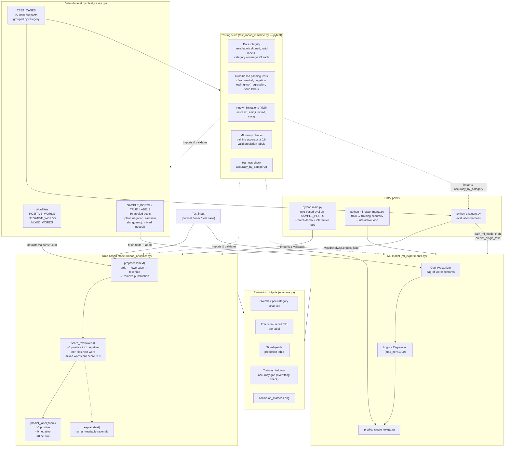

# Mood Machine — System Diagram

Overview of the main components, data flow, and testing suite.

## Reading the diagram

- **`dataset.py`** supplies both the lexicons for the rule-based model and the training set for the ML model. **`test_cases.py`** is strictly held out — the ML model never trains on it.
- The **rule-based pipeline** is `preprocess → score_text → predict_label`, producing `positive` / `negative` / `neutral`. It cannot emit `mixed` or `sarcasm`, which is why those tests are marked `xfail`.
- The **ML pipeline** is `CountVectorizer → LogisticRegression`, trained on `SAMPLE_POSTS`/`TRUE_LABELS`.
- **`evaluate.py`** is the shared harness: it runs both models over `TEST_CASES` and reports per-category accuracy, per-label precision/recall/F1, a side-by-side table, the train/test gap, and confusion matrices.
- **`test_mood_machine.py`** guards working behavior (passing tests), documents known failures (`xfail`), and sanity-checks data integrity, the ML model, and the harness itself.
